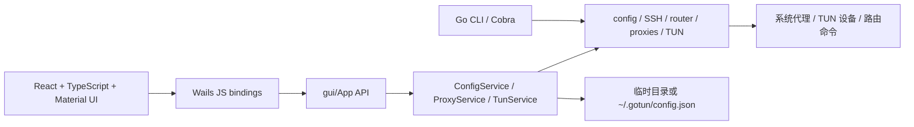

# GoTun 项目与 GUI 分支分析

分析日期：2026-10-18；GUI 交互与设置/日志补测更新于 2026-10-19（详见 [GUI_INTERACTION_AUDIT.md](GUI_INTERACTION_AUDIT.md)）。工作基线：本地 `gui` 的 `46bbe9c`，改动位于 `codex/gui-tests`。本报告区分已运行验证的行为、源码确认的未完成项和仍需真实平台验证的边界。

## 仓库与分支

- 已执行 `git fetch --all --tags --prune`。远程仍有 `main`、`gui`、`dev`、`socks5`、`tun`、`copilot/fix-git-remote-issue`；远程已删除的引用已清理，本地分支保留。
- 本地 `gui` 比 `origin/gui` 的 `bedbaf5` 多一个未推送提交 `46bbe9c`，包含 TUN GUI、提权重启和 DMG 打包支持。本次保留了该提交。
- `main` 位于 `df99375`。`main` 和本地 `gui` 无共同祖先，不能按普通增量合并假定两者仅相差 GUI；其他分支也存在本地与远程历史分叉。
- GUI 原依赖在 Go 1.26.0 下发生 gVisor 重复常量编译错误；本轮复现后移植了 `main` 已有的依赖修复，根模块与 GUI 同步最低 Go 1.25.5 / gVisor `b4724f244352`，没有合并或改写两条历史。Go 1.25.5 和 1.26.0 的两模块 race 测试均已运行。
- 原有 `clash_temp/`、`wails_temp/`、忽略的本地构建产物均保留。测试命令明确选择 `cmd`/`internal`，避免把临时参考代码算进产品测试。
- 工作未提交、未推送，也没有修改远程分支。

## 架构

| 位置 | 职责与当前状态 |
| --- | --- |
| `cmd/gotun/cli/root.go` | Cobra 参数、SSH 目标、服务组装、信号退出、TUN 提权。 |
| `internal/config` | 默认配置、认证/跳板机验证、IPv4 NAT 网络映射解析。 |
| `internal/proxy` | 密码/密钥 SSH、串联跳板、HTTP/CONNECT、SOCKS5 CONNECT；域名可在 SSH 端解析。 |
| `internal/router` | YAML、域名/关键词/IP-CIDR/最终匹配、全局直连/代理和拒绝。 |
| `internal/service` | GUI 配置持久化、代理生命周期、TUN 配置和状态。 |
| `internal/tun` | WireGuard TUN 与 gVisor IPv4 用户态协议栈、TCP 转发、DNS UDP 转 TCP、NAT、系统路由。 |
| `internal/sysproxy` | macOS networksetup、Windows 注册表、Linux gsettings/进程环境变量。 |
| `gui` | 独立 Go 模块，Wails 原生窗口和后端 API，`replace` 指向根模块。 |
| `gui/frontend/src/main.tsx` | 实际 React 入口；页面为 Home、Profiles、Logs、Settings。`App.tsx` 是未使用的遗留入口。 |

根目录 `go test ./...` 不会进入独立的 GUI Go 模块，也不会运行 React 测试，必须分层执行。

## 本轮测试复现并修复的问题

所有行为修复均以失败用例为依据；没有把待办中的自启动、托盘、导入导出等扩展成新功能。

| 范围 | 原行为 | 修复与验证 |
| --- | --- | --- |
| 路由 | `MATCH,DIRECT/REJECT` 丢失动作；`badexample.com` 误匹配 `example.com`；大小写/尾点/规则空白处理不一致 | 表驱动规则、边界和 fuzz 验证。 |
| 代理拒绝规则 | HTTP、CONNECT、SOCKS 都将 REJECT 继续送往 SSH | HTTP 返回 403，SOCKS 拒绝连接，断言没有向 SSH 发起转发。 |
| HTTP 转发 | CONNECT 预读缓冲区被丢弃；代理认证和 Connection 指定的头会泄漏到目标 | 真实 TCP 管道与源站检查缓冲数据、请求头、POST 请求体。 |
| 代理监听 | 端口占用仍返回启动成功；立刻停止可能解引用已置空的服务指针 | 初始化时同步绑定，启动/停止序列化，后台引用固定实例；占用端口和重启集成测试。 |
| 配置切换 | 再次启动被拒绝前已替换活动配置；并发 SetConfig/Start/Stop 有数据竞争；旧路由残留 | GUI 原子选择并启动配置；活动配置不被拒绝请求覆盖；并发 race 和跨配置请求测试。 |
| 活动连接 | Close 后已有直连隧道和 SOCKS 未完成握手仍存活；半关闭时响应丢失或挂起 | 追踪关闭活动连接，正常 EOF 传递 CloseWrite；HTTP/SOCKS × DIRECT/SSH 和并发到达测试。 |
| CLI 初始化 | 后续 SOCKS/TUN 初始化失败时已打开的 HTTP 监听未及时释放 | 为已创建资源注册清理，回归检查原端口可重新绑定。 |
| 密码 | 已传密码但启用交互认证时仍读终端；非交互空密码也读终端 | 配置密码优先，非交互缺密码直接报错；无终端测试。 |
| 配置存储 | 读写 API 共享 slice，调用者可绕过锁/Save 修改内部数据；密码 JSON 权限 0644；IPv6 SSH 地址拼接无括号 | 对嵌套数组做快照，文件新建/已有权限均为 0600，使用 JoinHostPort；跨重新加载和并发测试。 |
| GUI 初始化 | 损坏配置后继续解引用 nil；日志文件错误被忽略；未初始化设置接口假成功 | 保留可操作窗口并记录错误，接口返回明确错误；API 与错误路径测试。 |
| TUN 内存逻辑 | Peer IP 加一不进位；前缀硬编码 /24；输出队列空时自旋且关闭不退出；PacketBuffer/View 引用未释放 | 正确 IPv4 运算和 CIDR 前缀，阻塞读取并关闭 endpoint，释放引用；内存设备与真实 gVisor endpoint 测试。 |
| GUI 前端 | 初始 TUN starting/stopping 不继续轮询；编辑旧格式跳板配置会清空链 | 状态过渡轮询、保留旧链/显式禁用行为回归。 |
| 系统代理地址 | IPv6 缺括号，IPv6 通配地址被直接用作客户端代理地址 | 纯地址归一化测试，不执行系统命令。 |

另外修复了测试设施自身的 SSH 转发目标清理，避免无响应目标让测试永久挂起。

2026-10-19 补测还完成了四页中英文、主题/弹窗/表格/标签/对比度修复、设置保存串行合并与失败回滚、日志快照合并和清空确认、本地日期导出、verbose 真正启用 DEBUG、运行中 TUN 停止入口；对应红绿回归与原生逐按钮结果见交互报告。

## 仍未完成的功能

| 项目 | 源码现状 |
| --- | --- |
| 自启动 | `SetAutoStart` 只持久化布尔值，没有注册 launchd/登录项/对应平台服务。 |
| 托盘 | `SetMinimizeToTray` 只保存设置；没有托盘实现，窗口配置 `HideWindowOnClose=false`。 |
| 启动自动连接 | `AutoConnect`、`DefaultProfile` 字段存在，启动过程没有执行自动连接。 |
| 流量/请求统计 | `requests` 没有累加入口，`totalRequests` 不代表真实流量；没有收发字节统计。 |
| TUN 设备信息 | GUI `TunStats` 的设备名/IP 仍是 TODO，不能把空字段解释为已获取设备状态。 |
| 规则编辑器、配置导入导出 | 没有对应页面/API；当前仅选择外部规则文件。 |
| 原生文件类型过滤 | `OpenFileDialog` 的 filters 参数未写入 Wails options。 |
| 旧跳板链编辑 | 旧 `jumpHosts` 现在能安全保留，但结构化表单仍未展示/迁移旧链。 |
| 日志设置应用时机 | verbose/logFile 在启动时应用；保存后需重启，GUI 现已明确提示。设置并发覆盖、失败反馈及内存回滚已修复。 |
| 加密私钥 | 仍不支持受口令保护的私钥，代码返回相应错误。 |

## 优先处理的剩余风险

1. **SSH 主机身份没有验证。** `trySingleConnection` 使用 `ssh.InsecureIgnoreHostKey()`。本轮本地测试验证认证与转发，不代表抵御中间人攻击；需要设计 known_hosts/首次信任及 GUI 指纹确认。
2. **系统代理“恢复”尚不完整。** 代码保存 `origSettings`，但 Disable 主要关闭代理，没有真正恢复原代理地址、启用状态、bypass、SOCKS 及 Linux 原环境变量。部分命令失败被忽略。10月19日原生验收执行了现有公司配置的停止/启动，最终四类代理设置逐项与事前快照一致；这不证明 Disable 能恢复任意既有系统配置。
3. **TUN 启动/停止仍有时序风险。** GUI 服务层异步调用底层 Start 后立即标记 running，立即 Stop 可能在资源创建前消耗 `closeOnce`，之后创建的资源无法再次关闭。还没有特权运行反馈证明 TUN 真正就绪。
4. **路由失败与回滚不完整。** `setupRoutes` 记录错误仍返回 nil；Windows 添加路由会先删除同目标路由；退出未完整保存/恢复旧系统路由。需要在独立平台环境中完善事务与回滚测试。
5. **配置写盘不是原子替换。** Profile CRUD 仍先更改内存再保存，文件仍为截断后写入，磁盘故障可能使内存与磁盘不同步；UpdateSettings 已持锁并在失败时回滚内存，但未解决磁盘原子替换；0600 限制本机读取权限，不等于密码已加密或进入钥匙串。
6. **网络超时和长连接恢复未完整覆盖。** 真实 SSH 握手卡住、跳板中断、keepalive/重连、DNS 超时需要进一步故障注入。TUN 仅处理 IPv4，UDP 实现限 DNS 转 TCP；不能当作完整 UDP VPN。
7. **构建依赖较旧。** Vite 3/TypeScript 4 与 Material UI 7 会输出 `use client` 和 chunk 体积警告；没有在本轮做整套前端升级。

## 运行与验证记录

- 原生 macOS ARM64 GUI 已构建为 `gui/build/bin/GoTun.app`。
- 10月18日使用独立临时 HOME 启动 GUI，经原生界面保存无密码的本机测试配置，主页正确读取，日志页显示真实 Go 启动日志；测试进程退出码为 0。10月19日另按用户指定公司配置执行原生 SSH 测试和 HTTP 代理启停，并完成默认/最小窗口交互；没有启动真实 TUN，浏览器页面渲染受到保存权限/受管策略限制。
- CLI 已实际执行 `--version`、`--help`；参数错误、认证、本地代理启动/停止/重启经过自动测试。Linux/Windows AMD64 CLI 已交叉编译，交叉编译不等于平台实机测试。
- 根模块、独立 GUI 模块、React 前端分别运行；核心和 GUI 均执行 race，网络关闭并发另重复运行；覆盖率与最终结果见 `TESTING.md`。
- `scripts/install.sh` 只执行语法和 help 检查，没有下载发布包、写安装目录或修改用户 shell。
- macOS/Linux/Windows CI 已配置三平台核心测试及 macOS GUI 测试/打包。本轮尚未推送，因此没有 GitHub 托管 runner 的实际运行结果。

## 建议后续顺序

先处理主机身份验证、系统代理恢复及 TUN 启停/路由回滚，再完成真实 TUN 三平台验证；随后补流量统计、自启动/托盘/自动连接；最后集中整理后端日志国际化、旧跳板迁移和依赖升级。现有回归测试可以作为这些工作的起点。
